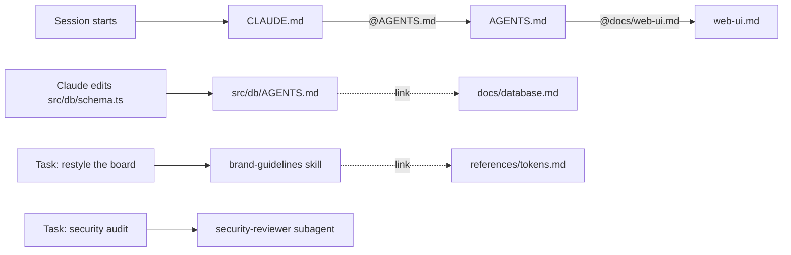

# Gapwatch: a Claude Code example repository

> [!WARNING]
> **Training repository. Do not deploy.** This app contains **deliberate security flaws** for Claude to find, and `.env.local` is committed **on purpose** with placeholder values. Never commit a real `.env.local` in your own projects.

Gapwatch is a small Next.js app that shows live London line status from the TfL API and analyses which lines are most often disrupted. The app is the excuse; the real subject is **how the repository is set up for Claude Code**:

- layered project context: `AGENTS.md`, `@` imports, nested files, linked docs
- a **skill** that loads automatically for UI work
- two **subagents**: a read-only security reviewer and a test engineer
- **permissions** and a **hook** that keep Claude away from secrets
- **specs** that turn exercises into agent-ready tasks
- **GitHub Actions** so you can `@claude-help` on issues and pull requests

Work through the [exercises](#exercises) to see each piece in action.

---

## Quickstart

You need **Node.js 22+** and [Claude Code](https://code.claude.com).

```bash
npm install          # install dependencies
npm run db:migrate   # create the local SQLite database
npm run dev          # start the app on http://localhost:3000
```

Sign in with the **viewer** or **admin** account. The usernames and passwords are in `.env.local`; open it in your editor. (Claude can't read that file, by design; see [Guardrails](#guardrails).)

Within a few seconds the live board fills with real TfL data, then refreshes every 2 minutes for as long as the server runs. The trends page stays empty until history builds up, or until you complete [exercise 01](specs/01-demo-history.md).

Then open Claude Code in this folder (`claude`) and start with the exercises.

## Commands

| Command | What it does | When to use it |
|---------|--------------|----------------|
| `npm install` | Downloads every library the project depends on into `node_modules/`. | Once after cloning, and whenever `package.json` changes. |
| `npm run dev` | Starts the app in development mode at http://localhost:3000. It reloads when you edit code, and starts the background TfL poller. | Day to day while working on the app. |
| `npm run build` | Creates an optimised production build and type-checks all the code. | To check that everything compiles before you commit. |
| `npm start` | Runs the production build from `npm run build`. | To try the app as it would run for real. |
| `npm test` | Runs the automated tests once (Vitest). | After any change; "done" means tests pass. |
| `npm run test:watch` | Runs the tests and re-runs them whenever a file changes. | While writing tests. |
| `npm run lint` | Checks the code for common mistakes and style problems (ESLint). | Before committing. |
| `npm run db:generate -- --name <change>` | Compares `src/db/schema.ts` with the existing migrations and writes a new SQL migration file to `drizzle/`. | After changing the database schema. |
| `npm run db:migrate` | Applies any pending migrations to the local database file `data/gapwatch.db`. | After cloning, and after generating or pulling a new migration. |

## The app in one minute

| Page | Who | What |
|------|-----|------|
| `/login` | everyone | Sign in as viewer or admin |
| `/` | viewer, admin | Live status of every polled line |
| `/trends` | viewer, admin | Most disrupted lines, by hour of day and by weekday |
| `/admin` | admin | Poller stats and a "Poll now" button |

A background poller (`src/instrumentation.ts` → `src/lib/poller.ts`) calls the TfL API every 2 minutes and stores one row per line in SQLite. Which transport modes are polled is set by `TFL_MODES` in `.env.local` (documented in `.env.example`).

---

## Repository anatomy

```
.
├── CLAUDE.md                      # one line: @AGENTS.md
├── AGENTS.md                      # project context: stack, commands, map, rules
├── docs/
│   ├── web-ui.md                  # imported into AGENTS.md with @ (always loaded)
│   ├── database.md                # linked from AGENTS.md (read on demand)
│   └── tfl-api.md                 # linked from AGENTS.md (read on demand)
├── src/
│   ├── db/
│   │   ├── CLAUDE.md              # one line: @AGENTS.md
│   │   ├── AGENTS.md              # DB rules; loads when Claude works in src/db
│   │   └── ...
│   ├── app/                       # pages and API routes
│   ├── lib/                       # auth, TfL client, poller
│   └── proxy.ts                   # redirects signed-out visitors
├── specs/                         # exercises written as specs
├── .claude/
│   ├── settings.json              # permissions + hook registration (shared with the team)
│   ├── hooks/
│   │   ├── protect-env.mjs        # blocks access to .env files
│   │   └── tests-only.mjs         # used by the test-engineer subagent
│   ├── skills/
│   │   └── brand-guidelines/      # SKILL.md + references/ (loaded for UI work)
│   └── agents/
│       ├── security-reviewer.md   # read-only reviewer
│       └── test-engineer.md       # writes and runs tests
├── .github/workflows/             # Claude GitHub Action (claude-actions.yaml)
├── .env.example                   # documented list of every env variable
└── .env.local                     # placeholder secrets (committed here only for training)
```

| File | Loaded when | Purpose |
|------|-------------|---------|
| `CLAUDE.md` → `AGENTS.md` | Every session start | What the project is, commands, where things live, rules |
| `docs/web-ui.md` | Every session start (`@` import) | UI engineering conventions |
| `src/db/CLAUDE.md` → `src/db/AGENTS.md` | When Claude reads or edits files in `src/db/` | Database rules |
| `docs/database.md`, `docs/tfl-api.md` | When Claude decides it needs them (plain links) | Detailed guides |
| `.claude/skills/brand-guidelines/SKILL.md` | When a task matches the skill's description (UI or copy work) | Brand rules |
| `.claude/skills/brand-guidelines/references/*` | When the skill says to read them | Token values, components, voice |
| `.claude/agents/*.md` | When Claude delegates to them, or you ask for one by name | Isolated helpers with their own tools and model |
| `.claude/settings.json` | Always, by the Claude Code harness | Permissions and hooks |
| `specs/*.md` | When you point Claude at one | Task definitions |

## How context loads

Claude can't read your whole repository up front, and you wouldn't want it to: every token of context costs attention. Good setups load **a little, always**, and **more, on demand**.



There are three mechanisms. This repo uses all of them so you can compare:

| Mechanism | Example here | When it loads | Use it for |
|-----------|--------------|---------------|------------|
| **`@` import** | `AGENTS.md` → `@docs/web-ui.md` | **Always**, at session start, inlined into the parent file | Splitting a long file into readable parts. It's **not** lazy, so keep imported files short. |
| **Nested file** | `src/db/AGENTS.md` | When Claude works on files in that folder | Rules that only matter in one area of the codebase |
| **Plain link** | "see [docs/database.md](docs/database.md)" | Only if Claude decides to read it | Long reference material |

Skills and subagents add two more layers:
- A **skill** is loaded only when the task matches its `description`, and its reference files only when the skill points to them.
- A **subagent** runs in its own separate context, so its exploration doesn't fill up yours.

> **Why `CLAUDE.md` *and* `AGENTS.md`?** `AGENTS.md` is the cross-tool convention many coding agents read. By default, Claude Code reads `CLAUDE.md` and only falls back to `AGENTS.md` when a project has no `CLAUDE.md` (the "Project instructions" setting can make it read both). A one-line `CLAUDE.md` containing `@AGENTS.md` keeps a single source of truth that works for every tool. The same trick is used in `src/db/`.

## Guardrails

Two layers protect this repo, configured in [`.claude/settings.json`](.claude/settings.json).

**1. Permission rules.** These decide what Claude may do without asking:

| Rule | Commands | Effect |
|------|----------|--------|
| `allow` | `npm run dev/build/lint`, `npm test`, `npm run db:*`, `git status/diff/log` | Runs without a prompt |
| `ask` | `npm install`, `git commit`, `git push`, every `gh` command | Claude must get your approval each time |
| `deny` | reading `.env` / `.env.local`, `rm -rf`, `curl`, `wget` | Refused outright |

**2. A PreToolUse hook.** [`.claude/hooks/protect-env.mjs`](.claude/hooks/protect-env.mjs) runs before every file read, search, edit and shell command. It inspects the tool's input and denies anything that mentions `.env` or `.env.local` (but allows `.env.example`). It explains to Claude why it was blocked, and logs the attempt to `.claude/hooks/blocked.log`.

**Why both?**
- **Deny rules** are declarative and simple. They match a tool plus a path or command pattern, and they're the first thing to reach for.
- **Hooks** are code. They see the full input of any tool (including PowerShell, or `node -e` reading a file), can return a helpful explanation that Claude acts on, and can log or alert.
- Neither is a complete security boundary on its own. Real secrets also belong in a secret manager, not a file in the repo.

**Instructions guide; hooks enforce.** Notice that `AGENTS.md` doesn't say "never read `.env.local`". It just points to `.env.example`. An instruction in a context file is advice the model usually follows. A hook runs in the harness and **always** applies, whatever the model decides.

A subagent can carry its **own** hooks: [`test-engineer.md`](.claude/agents/test-engineer.md) registers `tests-only.mjs` in its frontmatter, so it can write tests but not application code.

---

## Exercises

Each exercise is a spec in [`specs/`](specs/). Open it, read the goal, then use the "Try it" prompt with Claude. The "Watch for" section tells you what to notice about how Claude works.

1. **[Generate demo history](specs/01-demo-history.md)**: nested context files, linked docs, plan mode
2. **[Apply the brand](specs/02-apply-brand.md)**: a skill that triggers itself
3. **[Guardrails](specs/03-guardrails.md)**: permissions and hooks in action
4. **[Security audit](specs/04-security-audit.md)**: a read-only subagent; filing GitHub issues
5. **[Fix a finding, test first](specs/05-fix-flaw-test-first.md)**: the test-engineer subagent and a red/green loop
6. **[Use the TfL app key](specs/06-tfl-api-key.md)**: working around blocked secrets the right way
7. **[Add bus routes](specs/07-bus-routes.md)**: planning a bigger change, env-driven config
8. **[Claude in GitHub](specs/08-claude-in-github.md)**: `@claude-help` to refine an issue and review your pull request
9. **[Write your own spec](specs/09-write-a-spec.md)**: spec-driven development from the other side

New specs follow [`specs/_template.md`](specs/_template.md).

---

## GitHub Actions

The workflow in [`.github/workflows/claude-actions.yaml`](.github/workflows/claude-actions.yaml) runs Claude Code inside GitHub Actions, using [`anthropics/claude-code-action`](https://github.com/anthropics/claude-code-action). Mention `@claude-help` on an issue to refine it (clarify requirements, propose acceptance criteria), or on a pull request to get a review. It's **read-only by design**: Claude comments, but code changes happen locally. It reads the same `CLAUDE.md`, `AGENTS.md` and `.claude/` configuration as your local session, so the same guardrails apply in CI.

Only people with write access to the repository can trigger it.

**A custom trigger.** The action's default trigger is `@claude`. This repo changes it to `@claude-help` with one input, `trigger_phrase: "@claude-help"`, so a plain `@claude` does nothing here. A custom phrase is useful when you run more than one Claude workflow, or just want the name to say what it does. If you change it, update the workflow's `if:` checks too: they skip the run early, before a runner starts.

### Set up with your personal Claude token

If you have a Claude **Pro or Max** subscription (or a Team or Enterprise seat), you can authenticate the action with your own account:

1. **Install the Claude GitHub app** on the repository: https://github.com/apps/claude. It lets Claude comment and open pull requests.
2. **Create a long-lived token.** In a terminal where Claude Code is installed, run:
   ```bash
   claude setup-token
   ```
   Follow the browser sign-in. The command prints a token. Copy it; you won't see it again.
3. **Store it as a repository secret.** On GitHub go to **Settings → Secrets and variables → Actions → New repository secret**:
   - Name: `CLAUDE_CODE_OAUTH_TOKEN`
   - Value: the token from step 2
4. The workflow passes it to the action like this:
   ```yaml
   - uses: anthropics/claude-code-action@v1
     with:
       claude_code_oauth_token: ${{ secrets.CLAUDE_CODE_OAUTH_TOKEN }}
   ```
5. Test it: open an issue and comment `@claude-help what does this repository do?`

Usage counts against your own subscription's limits. Treat the token like a password: never paste it into a file in the repo.

**Shortcut:** inside Claude Code, run `/install-github-app`. It walks you through installing the app and adding the secret.

**Using API billing instead?** Create a key in the [Claude Console](https://platform.claude.com), store it as the secret `ANTHROPIC_API_KEY`, and pass `anthropic_api_key: ${{ secrets.ANTHROPIC_API_KEY }}` to the action instead.

---

## Apply this to your own repository

A checklist you can take away:

- [ ] **Start a `CLAUDE.md` (or `AGENTS.md` plus a one-line `CLAUDE.md`).** Keep it short: what the project is, how to run, test and lint it, where things live, and the handful of rules that really matter. Run `/init` for a first draft.
- [ ] **Move detail out.** Put area-specific rules in nested files next to the code, and long guides in `docs/` behind plain links. Use `@` imports only for things that should always be loaded.
- [ ] **Document your environment** in `.env.example`, so humans and agents never need to see the real values.
- [ ] **Add permission rules** to `.claude/settings.json`:
  - `allow` your test, lint and build commands
  - `ask` for anything that publishes or changes shared state (commits, pushes, `gh`)
  - `deny` reading secret files
- [ ] **Add a hook** for anything that must *always* be enforced, not just suggested.
- [ ] **Write one skill** for knowledge that's only sometimes relevant (brand, a framework, a deployment process). Make the `description` say exactly when to use it.
- [ ] **Create subagents** for jobs that benefit from isolation or restricted tools (review, testing, research).
- [ ] **Write tasks as specs**, with concrete acceptance criteria and pointers to context.
- [ ] **Add the GitHub Action**, so the same context works in issues and pull requests.

## About the flaws

The codebase contains several intentional security weaknesses of the kind that turn up in real projects. They exist so exercise 04 has something to find. The answers aren't in this repository, which is deliberate: anything committed here is visible to Claude too.
